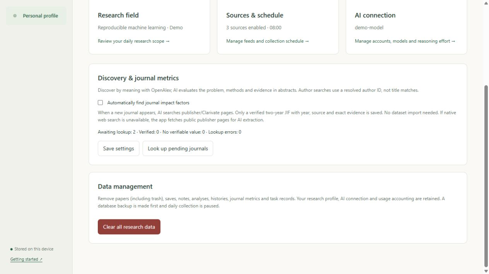
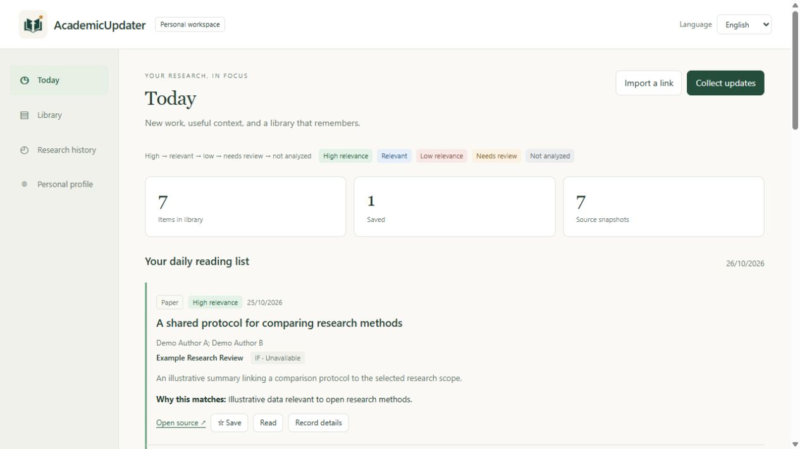
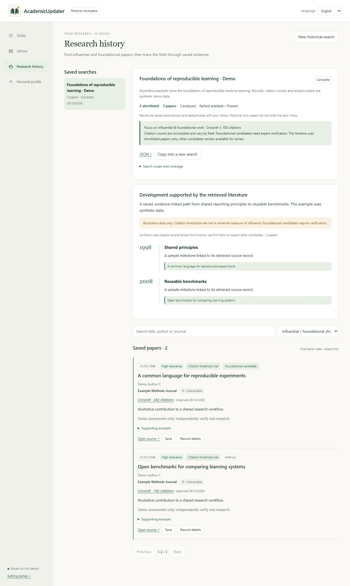

<p align="center"></p>

# AcademicUpdater

[English](README.md) | [简体中文](README.zh-CN.md)

An AI-powered, local-first research assistant for tracking papers and industry updates, discovering influential and foundational work, and organizing a deduplicated personal library.

**Version 1.8.2 · MIT license · Contributions welcome**

## Semantic discovery and author searches

AI interprets the whole research question and plans complementary natural-language searches. **OpenAlex semantic search** retrieves candidates using embeddings of titles and abstracts; Crossref/arXiv supply complementary text-based retrieval. AI then assesses each available abstract against the problem, method, target and exclusions, with grounded quotations. Missing abstracts mean uncertain topical relevance, not a claim of full-text reading.

**Author-centered requests use verified identities.** After interpreting your prompt, the app shows the author name, institution, ORCID when available, and resolved OpenAlex identity for review. It retrieves works by author ID and checks each authorship record, rather than searching titles for the person's name. Institution disambiguates the person without excluding earlier career papers. An unspecified topic stays unrestricted; author mode does not apply the landmark-only filter. Ambiguous identities stop with an actionable message.

For example, “Luca Cocchi at QIMR / QIMR Berghofer, with no topic restriction” is treated as an author bibliography. Copy and reinterpret an older search to use the new strategy; existing searches and assessments retain their original checkpoints.

OpenAlex semantic retrieval returns at most **50 candidates per description**, with up to three descriptions and explicit source-limit reporting. Public access has its own quota and author paging is bounded by 10,000 records. Coverage depends on source indexing and access, not a promise to find every paper. See [semantic search](https://help.openalex.org/api/semantic-search/) and [author filtering](https://help.openalex.org/api/filtering/).

## Automatic journal impact factors

New journals and old papers missing IF enter an automatic lookup queue. AI searches public publisher/Clarivate evidence; when native web search is unavailable, the app resolves the publisher homepage through OpenAlex, reads public metrics pages, and asks AI to extract the value. A two-year **JIF, metric year, source URL and exact quotation** must pass verification before saving. CiteScore, five-year IF, model guesses and unsupported values are rejected. No dataset import is needed. Publisher restrictions or missing evidence can leave IF unavailable; failures are shown and retried. Manual corrections remain available in paper details.



## Automatic updates and parallel work

Daily updates and independent history searches can run together. Paper assessment defaults to **3 concurrent AI requests**, shared across all tasks. Click **Set parallelism** beside active tasks or in **Personal profile → AI connection** to choose 1–64 while tasks keep running. The task panel shows actual active requests per task and total waiting requests. The original setting also remains in **Sources & schedule**. Raising the limit admits more requests immediately; lowering it lets in-flight requests finish. History processes up to 10 papers per request. Each task has its own pause/resume control; completed results are retained. Up to 16 independent jobs can be active. Model speed, reasoning effort, provider limits and the existing daily request budget still apply.

Enable **Windows login startup** to launch in the background after signing in. The scheduler catches up that day's missed update after the configured time, and the next day's collection can start while an older analysis continues. The computer must be awake and online. Unexpected process exits resume from saved progress after restart; transient network failures use bounded retries, daily-budget pauses continue after local midnight, and manual pauses stay paused. Recent activity shows interruption causes and retry times. After five automatic job retries, or for authentication/configuration errors, resolve the displayed issue and resume manually.

**Learn from saved papers** refines the understood field before a new collection only when the current saved set changes, including unsaving or deleting/restoring saved papers. It recomputes from your original applied field and explicit exclusions, so removed papers stop contributing positive evidence. No change means no learning request; removing all saves restores the baseline without AI. For more than 80 saved papers, an evenly distributed sample is used and its size is shown. Your original prompt, pending drafts, old analyses and independently configured historical searches remain available. If learning fails, collection uses the existing field and reports the deferred update.

Set **Daily AI requests to 0** for no application daily cap. Increasing an exhausted budget makes eligible paused jobs retry automatically. Provider quotas, rate limits and charges still apply.

## Manage your collection

Delete a library record or a saved historical search to move it to **Trash**, then restore it whenever needed. Open **Trash** in the sidebar, then switch between **Library records** and **Historical searches**. Search and restoration update immediately. Deleting a search keeps its papers in the library. Deleting a record hides it from Today, history results and normal exports; collection will not automatically reimport it. Saved notes, analyses and search progress are retained. Pause any running task before deleting or restoring records. Database backups include trash. A timeline citing removed papers is hidden until those papers are restored or the search is run again.

**Personal profile → Data management** can clear research data, including trash, saved papers, notes, analyses, histories, journal metrics and task records. It requires `CLEAR ALL`, no running jobs, and a successful automatic backup. Research settings, AI credentials and usage accounting remain; daily collection is paused. This is separate from reversible Trash.

## Starting a historical search

Interpreting your field with AI saves a **draft**, not a paper search. Review the understood field and queries, then choose **Confirm field and search papers**. The app distinguishes searches not started, source failures, pending AI review and an empty shortlist. You can inspect all retrieved candidates without weakening the influential/foundational criteria.

Quoted phrases, AND, OR and parentheses work in history queries. arXiv receives its native Boolean syntax; Crossref gets separate ranked text queries with a shared candidate cap. See the [arXiv query manual](https://info.arxiv.org/help/api/user-manual.html#51-details-of-query-construction) and [Crossref API documentation](https://github.com/Crossref/rest-api-doc).

When you resume an older search with Boolean queries, affected source queries restart once with the corrected syntax. Saved papers and assessments remain; previous cursors are archived in the search export. Paused or deleted searches do not restart automatically.

## See it in action

Screenshots of the **real application** using synthetic demonstration records. Titles, authors, citation counts and assessments below are illustrative; no personal library or account is shown.



<details>
<summary>Research history: a saved shortlist and referenced timeline</summary>



</details>

[Suggest a feature](https://github.com/QirongWu625/AcademicUpdater/issues/new?template=feature_request.yml) · [Report a bug](https://github.com/QirongWu625/AcademicUpdater/issues/new?template=bug_report.yml) · [Contribute a pull request](CONTRIBUTING.md)

## What it does

- **Today:** collect from OpenAlex, Crossref, arXiv and public RSS/Atom feeds; rank analyzed items by relevance with color and text labels.
- **Research field:** describe your interests in a prompt, then review and edit the AI's interpretation, bilingual field names, keywords, exclusions and search queries before applying it.
- **Library:** save papers and updates with authors, journal, notes, reading status and source versions. Filter immediately and sort by date, title, first-author surname, journal, relevance or impact factor.
- **Research history:** save a separate historical search, prioritize influential and foundational candidates, and build a referenced timeline from the shortlist. Searches and results can be reopened and exported.
- **Journal metrics:** automatically retrieve and verify public impact factors with a year, source and evidence. Missing values remain missing; no commercial journal-metrics dataset is bundled.
- **AI settings:** use an eligible ChatGPT sign-in connection, an OpenAI API key, or a compatible local model server. Select the model and its supported reasoning effort. Within the same connection, changes apply to the next unsent request in running or resumed tasks, including queued requests and retries. In-flight requests retain their original settings; completed papers are not reprocessed. The task panel shows next-request settings separately from in-flight model/effort counts.
- **Persistent work:** SQLite storage, identifier-based deduplication, backups, exports, per-paper checkpoints, pause/resume and recovery after interruption.
- **English and Chinese:** switch the interface language and configure the summary language separately. Personal profile contains research scope, sources, schedule and AI connection.

## Install and run

Requires **Python 3.11 or later**. Windows is the primary desktop platform. The core application can run on macOS/Linux; encrypted saved credentials currently use Windows DPAPI, so use an environment API key or a compatible local model there.

Download the source or clone this repository, then open a terminal in its folder.

### Windows

```powershell
python -m venv .venv
.venv\Scripts\python -m pip install -r requirements.txt
.venv\Scripts\python run.py --open
```

After installing dependencies, you can also double-click `Start.cmd`. It prefers the project's `.venv` and runs the application in the background. `Stop.cmd` stops that background instance; closing the browser does not stop it.

### macOS / Linux

```sh
python3 -m venv .venv
.venv/bin/python -m pip install -r requirements.txt
.venv/bin/python run.py --open
```

The application opens at **http://127.0.0.1:8765/**. Use Ctrl+C to stop a foreground instance. It binds to loopback and is intended for a single user on their own computer.

## First use

1. Open **Personal profile → AI connection**. Choose a provider, connect it, load models and select a supported model and reasoning effort. A ChatGPT subscription does not include OpenAI API billing; sign-in availability depends on account eligibility and the provider. The application never silently switches to the paid API.
2. Open **Research field**, enter your prompt, review the interpreted field and search terms, and apply them. You can also enter a field and queries manually without AI.
3. Configure **Sources & schedule** with paper sources and RSS feeds for the industry or conference updates you want. Start collection and review Today.
4. Use **Research history** for a saved historical search without changing your daily scope. Start with a small result cap to check query quality before collecting a broad field.

The in-app bilingual [guide](http://127.0.0.1:8765/guide) is available while the app runs.

For environment-based OpenAI credentials, set `OPENAI_API_KEY` in the environment that launches the application and choose the API provider. Do not put credentials in source files. Local servers must support the application's OpenAI-compatible chat-completions requests and structured responses.

## How historical selection works

New topic searches default to focused discovery; author searches use verified authorship without the landmark restriction. Crossref combines citation-ranked and relevance-ranked candidates. Relevant papers qualify through a configurable citation threshold (default 100) or an abstract-supported foundational contribution. The default view and timeline show only shortlisted papers; other candidates remain available for review. Citation counts carry their source and observation date, and foundational labels remain candidates for expert verification. Existing saved searches are preserved. See [the selection rules](docs/RESEARCH_HISTORY.md).

## Data and upgrades

- `data/academicupdater.sqlite3` stores your library, settings, research scopes, notes, analyses and historical searches.
- `data/backups/` contains pre-collection database backups, with unique timestamps; clearing also creates a backup.
- `data/credentials.dpapi` contains saved credentials encrypted for the current Windows user. It is excluded from library exports.
- JSONL/CSV library exports are useful for data exchange; the SQLite database is the complete application backup.

Before updating, stop the application and back up the complete `data/` folder. Replace the source files while preserving `data/`, then restart. Schema migrations retain existing papers, saved status, notes and analyses. Credentials copied to another computer or OS account may not be decryptable; reconnect there. Avoid running two versions against the same database.

Interrupted collection/analysis jobs resume on startup. Manual pauses require **Resume**; daily-budget pauses retry after local midnight or an increased budget. A request interrupted before its result was saved may be sent again; saved results are checkpointed.

The public repository intentionally contains no personal library, credentials or runtime logs. Use a separate data folder for experiments:

```sh
python run.py --port 8766 --data-dir ./work/dev-data --no-scheduler
```

## Coverage and limitations

- Daily scheduling works while the application is running and the computer is awake. The default is 08:00 at a fixed UTC+10 offset; configure your own time and offset. Windows login startup is optional in Personal profile.
- AI works from titles and abstracts/descriptions, not full-text review. Assessments and timeline narratives need human checking; they do not prove historical priority.
- “All matches” means results retrievable for the chosen queries and source limits, not every paper in a field. Broad queries may return weak matches; source limits and failures are displayed. The history overview uses up to 80 relevant papers sampled across publication years; all candidates and individual assessments remain saved.
- Matching DOI, arXiv ID, source ID or canonical URL can reconcile records. Similar titles alone are not automatically merged.
- Impact factors require verified public evidence or a manual correction, and carry their metric year. Preprints and other inapplicable record types do not receive an inferred journal IF.
- This is a local personal application, not a hosted multi-user service. Do not expose its port publicly without designing and reviewing an appropriate authentication and deployment layer.

## Contribute

Feature ideas, bug reports, translations, documentation and pull requests are welcome. Please read [CONTRIBUTING.md](CONTRIBUTING.md). Issue templates support English and Chinese; either language is welcome.

Useful contribution areas include additional source connectors, better historical search quality, cross-platform credential storage, accessibility and import/export interoperability. Please discuss large architectural changes before implementing them.

```sh
python -m pip install -r requirements.txt
python -m unittest discover -s tests -v
python scripts/check_public_tree.py
node --check static/app.js
node --check static/history.js
node --check static/i18n.js
```

Node.js is needed only for the JavaScript syntax checks, not for running the application. Tests use isolated temporary databases and mocked provider responses; they do not require personal AI credentials. GitHub Actions is configured to run backend tests and syntax checks on Windows and Ubuntu with Python 3.11 and 3.13.

See [architecture](docs/ARCHITECTURE.md), [changes](CHANGELOG.md), and [security guidance](SECURITY.md). The code is licensed under [MIT](LICENSE). Third-party content and services remain subject to their own terms.

### Collection recovery and journal metrics

Daily collection uses supported OpenAlex semantic filters and checks the exact date window locally. Reaching a candidate cap is a completed run with limited coverage; failed sources can be resumed without repeating successful collection or completed analyses.

Automatic IF includes the metric year and publisher source. Directly accessible pages are checked against the original text, journal identity and JIF table column. When the publisher denies direct access, two independent AI web reads must agree, each backed by an actual page-open event, explicit dated JIF and ISSN. These are labeled **AI web sources**; they remain model-extracted evidence, not a licensed JCR feed or an exact local HTML verification. Conflicting or unsupported values remain missing. Profile shows recent lookup issues, and Refresh immediately retries missing values. Manual corrections are preserved.

IF lookup drains the eligible queue in one continuous task. Repeated Retry clicks show the active task without requeuing failures. Profile counts update live, including waiting, querying, found, unavailable and failed. Failed entries retain their retry cooldown; manual pauses, sign-in problems and usage limits remain visible barriers.
