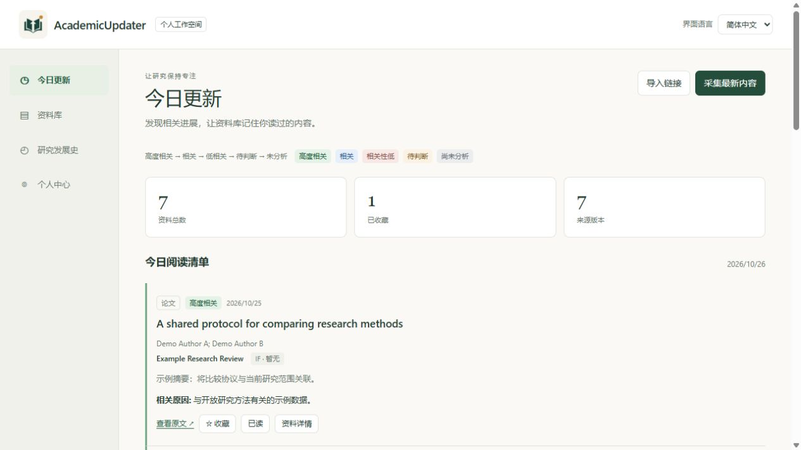
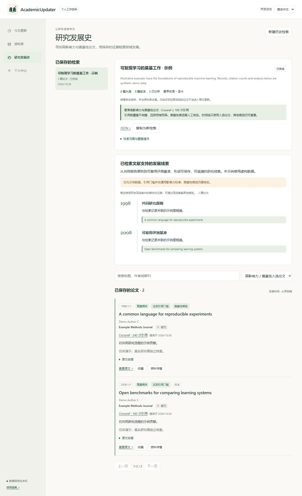

<p align="center"></p>

# AcademicUpdater

[English](README.md) | [简体中文](README.zh-CN.md)

一款 AI 驱动、本地优先的科研助手，用于跟踪论文与行业动态、发现高影响力及奠基性工作，并构建自动去重的个人资料库。

**版本 1.6.1 · MIT 许可证 · 欢迎贡献**

## 自动更新与并行运行

每日更新与独立历史检索可以同时运行。论文评估共享 **3 个并行 AI 请求**，可在 **个人中心 → 来源与计划** 调整为 1–8 个；历史评估每个请求最多处理 10 篇。每项任务可单独暂停和继续，已完成结果会保留，最多同时运行 8 项独立任务。模型速度、推理档位、服务方限额和已有每日请求额度仍然生效。

启用 **Windows 登录自启** 后，登录电脑即可在后台启动。若已过设定时间，会补跑当天更新；前一天的分析尚未结束时，新一天也能采集。电脑需保持唤醒并联网。意外退出后在重新启动时从断点恢复；网络故障退避重试，每日额度用尽则在当地次日继续；手动暂停保持暂停。运行记录显示中断原因与重试时间。连续 5 次自动任务重试仍失败，或遇到登录／配置问题时，需按提示处理后手动继续。

**根据收藏学习领域** 会在新一轮采集前检查当前收藏集合，包括取消收藏、删除或恢复已收藏论文。只有集合变化才重新学习；始终以原始已应用领域及明确排除条件为约束，移除的论文不再作为正向偏好。全部取消收藏时直接恢复原领域，无需 AI。超过 80 篇时均匀抽样，并显示实际样本数。原始提示词、尚未应用的草稿、旧分析和独立历史检索保持可用。学习暂时失败时仍使用已有领域采集，并显示暂缓原因。

## 管理资料

在资料库条目或已保存检索旁点击**删除**，即可移至**回收站**，之后随时恢复。从左侧导航进入独立的**回收站**，可切换**资料条目**和**历史检索**，搜索与恢复立即生效。删除检索会保留资料库论文；删除论文则会从今日更新、历史检索结果和常规导出中隐藏，采集时不会自动加回。已保存的笔记、分析和检索进度会保留。删除或恢复前请先暂停运行中的任务。数据库备份包含回收站；引用了已删除论文的时间线会暂时隐藏，恢复论文或重新运行检索后可再次查看。

## 启动历史检索

“让 AI 理解领域”只会生成已保存的**草稿**，不会自动检索论文。确认实际研究领域与检索词后，点击**确认领域并检索论文**。界面会区分尚未检索、来源失败、待 AI 评估及暂无入选论文；可随时查看全部候选，而不降低高影响力／奠基性筛选标准。

历史检索式支持双引号短语、AND、OR 和括号。程序会转换成 arXiv 的布尔语法，或拆成 Crossref 的多个相关性检索；分支共享原定候选上限。实现依据：[arXiv 检索手册](https://info.arxiv.org/help/api/user-manual.html#51-details-of-query-construction)、[Crossref API 文档](https://github.com/Crossref/rest-api-doc)。

继续旧版布尔检索时，受影响的来源会使用修正后的检索式重新获取一次；已保存论文和评估保留，原游标会归档到检索导出文件。已暂停或删除的检索不会自动运行。

## 界面演示

下图来自**真实运行的应用**，使用隔离的虚构示例数据。标题、作者、引用数与分析仅供演示，不包含个人资料库或账号信息。



<details>
<summary>研究发展史：保存的精选论文与引用时间线</summary>



</details>

[提出功能建议](https://github.com/QirongWu625/AcademicUpdater/issues/new?template=feature_request.yml) · [反馈问题](https://github.com/QirongWu625/AcademicUpdater/issues/new?template=bug_report.yml) · [参与 Pull Request](CONTRIBUTING.md)

## 已实现的功能

- **今日更新：**从 Crossref、arXiv 和公开 RSS/Atom 获取内容，按相关性排列已分析条目，用颜色和文字共同标识。
- **研究范围：**用提示词描述兴趣，检查并修改 AI 理解的中英文领域、关键词、排除项及检索词，再应用到日常采集。
- **资料库：**保存作者、期刊、笔记、阅读状态、收藏及来源版本。筛选立即生效，可按日期、标题、第一作者姓氏、期刊、相关性及影响因子排序。
- **研究发展史：**保存独立历史检索，优先寻找高影响力及奠基性候选，从入选论文生成带引用的时间线；结果可重新打开、筛选和导出。
- **期刊指标：**手动录入或导入带年份及来源的 IF。缺失值保留为缺失；不附带商业期刊指标数据库。
- **AI 连接：**支持具备相应资格的 ChatGPT 登录、OpenAI API 和兼容的本机模型服务，可选择模型及其支持的推理强度。
- **持久化与恢复：**SQLite 存储、基于标识符的去重、备份、导出、逐篇保存、暂停与继续、中断恢复。
- **中英文界面：**界面和摘要语言分别设置；研究范围、来源与计划、AI 连接统一放在个人中心。

## 安装与启动

需要 **Python 3.11 或更新版本**。Windows 是主要桌面平台。核心应用也可在 macOS/Linux 运行；目前保存凭据使用 Windows DPAPI 加密，其他平台请使用环境变量中的 API 密钥或兼容的本机模型。

下载源码或克隆仓库，在项目文件夹中打开终端。

### Windows

```powershell
python -m venv .venv
.venv\Scripts\python -m pip install -r requirements.txt
.venv\Scripts\python run.py --open
```

安装依赖后，也可双击 `Start.cmd`。启动器优先使用项目中的 `.venv`，并在后台运行应用。双击 `Stop.cmd` 停止后台实例；关闭浏览器不会停止服务。

### macOS / Linux

```sh
python3 -m venv .venv
.venv/bin/python -m pip install -r requirements.txt
.venv/bin/python run.py --open
```

访问 **http://127.0.0.1:8765/**。前台运行时可按 Ctrl+C 停止。服务仅监听本机，面向个人使用。

## 首次使用

1. 在 **个人中心 → AI 连接** 选择服务，完成连接，加载模型并选择支持的推理强度。ChatGPT 订阅不包含 OpenAI API 费用；登录接入取决于账号资格与服务方支持，应用不会自动切换到付费 API。
2. 在 **研究范围** 输入提示词，检查解释出的领域和检索词，再应用设置。也可以不使用 AI，手动填写领域与检索词。
3. 在 **来源与计划** 设置论文来源，以及所需行业或会议的 RSS 订阅，开始采集并查看今日更新。
4. 在 **研究发展史** 创建独立的历史检索，不必改变日常范围。建议先用较小上限检查检索词质量，再扩大采集。

运行后可打开应用内的[双语指南](http://127.0.0.1:8765/guide)。

若使用环境变量密钥，在启动应用的环境中设置 `OPENAI_API_KEY`，并选择 API 服务。不要把密钥写进源码。本机模型服务需兼容应用使用的 OpenAI chat-completions 请求及结构化回答。

## 历史论文如何筛选

新检索默认启用精选模式。Crossref 结合引用量排序与相关性排序获取候选；论文先满足相关性，再达到可调引用门槛（默认 100），或具有摘要依据支持的奠基性贡献。默认列表与时间线仅使用入选论文，其他候选保留供核查。引用数附带来源及查询时间，奠基性标签为需专业核查的候选判断；旧检索不会被覆盖。详见 [筛选规则](docs/RESEARCH_HISTORY.md)。

## 数据与升级

- `data/academicupdater.sqlite3`：资料、设置、研究范围、笔记、分析和历史检索。
- `data/backups/`：采集前数据库备份，每个 UTC 日期至多一份。
- `data/credentials.dpapi`：与当前 Windows 用户绑定的加密凭据，不包含在资料导出中。
- JSONL/CSV 用于交换资料；完整恢复应用状态应使用 SQLite 数据库备份。

升级前先停止应用，备份完整的 `data/` 文件夹。替换源码时保留 `data/`，再重新启动。数据库迁移会保留旧论文、收藏、笔记和分析。换电脑或系统账号后，加密凭据可能无法解密，需要重新连接。不要让两个版本同时使用同一数据库。

意外中断的采集或分析会在启动后恢复。手动暂停、达到额度上限的任务需点击 **继续**。强制退出前尚未保存的请求可能重试；已保存结果有检查点。

公开仓库不包含个人资料库、凭据及运行日志。开发或试验时使用独立数据目录：

```sh
python run.py --port 8766 --data-dir ./work/dev-data --no-scheduler
```

## 覆盖范围与限制

- 定时采集要求应用运行且电脑唤醒。默认 08:00、固定 UTC+10，可自行修改时间与偏移量；不会安装系统开机任务。
- AI 根据标题和摘要／描述分析，并非阅读全文。相关性及时间线需要人工核查，不能证明某篇工作是历史上的“首次”。
- “全部匹配”指给定检索词下来源允许取得的结果，不代表领域内全部文献。宽泛检索可能产生低相关结果，界面会显示上限及错误。发展概述最多使用按年份选取的 80 篇相关论文，全部候选与逐篇分析仍然保存。
- 相同 DOI、arXiv 编号、来源编号或规范链接可合并；只有标题相似的记录不会自动合并。
- IF 为用户提供、带年份的指标。预印本等不适用的资料类型不会被推测赋值。
- 这是本机个人应用。若要作为公开的多人服务部署，需要另行设计和审查身份验证及部署方案。

## 参与贡献

欢迎功能建议、问题反馈、翻译、文档和 Pull Request；可使用中文或英文。请先阅读 [贡献指南](CONTRIBUTING.md)。

适合参与的方向包括新来源接入、历史检索质量、跨平台凭据保存、无障碍支持以及导入导出互通。涉及较大架构调整时，请先通过 Issue 讨论。

```sh
python -m pip install -r requirements.txt
python -m unittest discover -s tests -v
python scripts/check_public_tree.py
node --check static/app.js
node --check static/history.js
node --check static/i18n.js
```

Node.js 只用于 JavaScript 语法检查，运行应用不需要。测试使用隔离的临时数据库和模拟服务响应，不需要个人 AI 凭据。GitHub Actions 已配置 Windows/Ubuntu、Python 3.11/3.13 的测试与语法检查。

另见 [架构说明](docs/ARCHITECTURE.md)、[更新记录](CHANGELOG.md) 和 [安全说明](SECURITY.md)。代码采用 [MIT 许可证](LICENSE)；第三方内容和服务仍受其各自条款约束。
